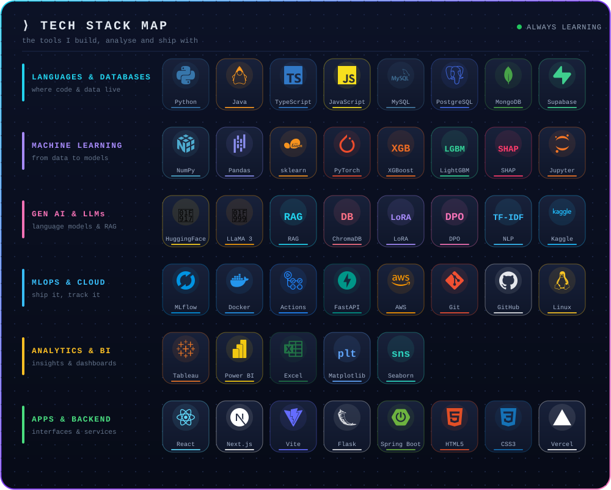

 

<!-- HERO BANNER -->

 

  

**I don't just want to understand AI. I want to build useful things with it.**

*An MCA student focused on AI & Data Analytics, developing practical skills in machine learning, data science, and AI-powered applications.*

---

## `01` — The person behind the code

Hi, I'm **Preetham V R** — an aspiring AI/ML Engineer and Applied AI Engineer from India.

I'm building my foundation through hands-on projects, experiments, and practical implementation. My goal is to understand not only how a model works, but also how to turn data and algorithms into applications that people can use.

- 🎓 **Education:** MCA — AI & Data Analytics
- 🧠 **Focus:** Machine Learning, Data Science, Applied AI
- 🔬 **Learning by building:** Experiments, model comparisons, and end-to-end applications
- 🛠️ **Current approach:** Understand the concept → implement it → evaluate it → document it
- 🎯 **Career goal:** AI/ML Engineer or Applied AI Engineer

 

> **My engineering philosophy:** Build with curiosity. Measure with evidence. Improve with feedback.

---

## `02` — Inside my AI systems lab

I organize my work around three connected areas.

<table>
<tr>
<td width="33%" valign="top">

### 🧠 Machine Learning

Learning how data becomes predictions.

- Data cleaning and EDA
- Feature engineering
- Classification and regression
- Model comparison and evaluation
- Experiment-driven learning

</td>
<td width="33%" valign="top">

### 🤖 Applied AI

Exploring how intelligent capabilities become usable tools.

- AI-powered analytics
- Natural-language data interaction
- Text classification
- Practical application workflows
- Human-centered AI interfaces

</td>
<td width="33%" valign="top">

### 📊 Data & Engineering

Building the foundations behind reliable results.

- Python and NumPy
- Pandas-based analysis
- Data visualization
- APIs and application structure
- Reproducible experiments

</td>
</tr>
</table>

---

## `03` — Featured projects

These are the projects that best represent the areas I am exploring. Each repository is a chance to practice a different part of the AI and software development workflow.

### 🔷 01. InsightAI Analytics

**An AI-powered data analytics platform**

A full-stack analytics project designed to help users explore datasets, understand patterns, and interact with data through an application interface.

**What it explores**
- CSV and Excel dataset analysis
- Statistical summaries and data-quality insights
- Interactive visualizations and correlation analysis
- Machine learning-assisted analysis
- Natural-language dataset interaction
- API-driven application architecture

**Technology:** React · FastAPI · Python · Pandas · NumPy · Scikit-learn · Recharts

---

### 🏡 02. Bengaluru Real Estate Analytics & ML

**Turning property data into insights**

A data-focused project exploring Bengaluru's real estate market through analytics and machine learning.

**The engineering questions I want to answer**
- Which property features matter most?
- How should the data be cleaned and prepared?
- Which model performs best on unseen data?
- How can prediction errors be understood and communicated?

**Focus areas:** Data analysis · Feature engineering · Regression · Model evaluation

---

### 💬 03. Sentiment Analysis

**Teaching machines to interpret text**

An NLP project exploring sentiment classification with traditional machine learning and neural-network approaches.

**What it explores**
- Text preprocessing and exploratory analysis
- TF-IDF-based feature extraction
- Classical classifiers, including Logistic Regression and Linear SVM
- Neural approaches using PyTorch
- Model comparison and evaluation

**Technology:** Python · Scikit-learn · NLP · TF-IDF · PyTorch

---

### 🩺 04. Diabetic Retinopathy Project

**Exploring AI for medical-image analysis**

A project in my portfolio focused on diabetic retinopathy. The repository is the place to explore the implementation and its current progress.

**Areas to document as the project develops**
- Dataset and image preprocessing
- Model architecture and training approach
- Evaluation results and class-wise performance
- Limitations, potential bias, and responsible use

**Important:** This is an educational project, not a medical diagnostic tool.

---

### ⚡ 05. NumPy Mastery

**Building strong foundations for numerical computing**

A hands-on learning repository focused on understanding NumPy through exercises and notebooks.

**Topics**
- Arrays, indexing, and slicing
- Broadcasting and vectorization
- Reshaping and array operations
- Numerical statistics and linear algebra
- Practical experiments with numerical computing

---

## `04` — My technology toolkit

These are the tools I use or explore across my current projects. My proficiency is developing through practice.

### Languages & Data

### Machine Learning & Analytics

### Application Development

### Working Environment

---

## `05` — What I'm learning next

My roadmap is focused on building depth, not collecting technology names.

<table>
<tr>
<td width="50%" valign="top">

### 🔬 Machine Learning

- [ ] Build complete Scikit-learn workflows
- [ ] Understand cross-validation and data leakage
- [ ] Compare models with appropriate metrics
- [ ] Improve feature engineering
- [ ] Perform error analysis and model interpretation

</td>
<td width="50%" valign="top">

### 🚀 Applied AI Engineering

- [ ] Improve API design and error handling
- [ ] Add automated tests to projects
- [ ] Learn model serving and deployment
- [ ] Explore LLM applications and retrieval systems
- [ ] Build reproducible, documented projects

</td>
</tr>
</table>

---

## `06` — GitHub activity

 

---

## `07` — Let's connect

I'm interested in learning from engineers, collaborating on practical projects, and growing through feedback.

If you're working on machine learning, data science, or useful AI applications, I'd be happy to connect.

  

*Curiosity starts the experiment. Engineering turns it into something useful.*

<!-- HERO BANNER -->

 

 

  

**I don't just want to understand AI. I want to build useful things with it.**

*An MCA student focused on AI & Data Analytics, developing practical skills in machine learning, data science, and AI-powered applications.*

---

## `01` — The person behind the code

Hi, I'm **Preetham V R** — an aspiring AI/ML Engineer and Applied AI Engineer from India.

I'm building my foundation through hands-on projects, experiments, and practical implementation. My goal is to understand not only how a model works, but also how to turn data and algorithms into applications that people can use.

- 🎓 **Education:** MCA — AI & Data Analytics
- 🧠 **Focus:** Machine Learning, Data Science, Applied AI
- 🔬 **Learning by building:** Experiments, model comparisons, and end-to-end applications
- 🛠️ **Current approach:** Understand the concept → implement it → evaluate it → document it
- 🎯 **Career goal:** AI/ML Engineer or Applied AI Engineer

 

> **My engineering philosophy:** Build with curiosity. Measure with evidence. Improve with feedback.

 

🌐 **Portfolio:** [portfolio-lime-eight-d4nwl00cu2.vercel.app](https://portfolio-lime-eight-d4nwl00cu2.vercel.app/)

---

## `02` — Inside my AI systems lab

I organize my work around three connected areas.

<table>
<tr>
<td width="33%" valign="top">

### 🧠 Machine Learning

Learning how data becomes predictions.

- Data cleaning and EDA
- Feature engineering
- Classification and regression
- Model comparison and evaluation
- Experiment-driven learning

</td>
<td width="33%" valign="top">

### 🤖 Applied AI

Exploring how intelligent capabilities become usable tools.

- AI-powered analytics
- Natural-language data interaction
- Text classification
- Practical application workflows
- Human-centered AI interfaces

</td>
<td width="33%" valign="top">

### 📊 Data & Engineering

Building the foundations behind reliable results.

- Python and NumPy
- Pandas-based analysis
- Data visualization
- APIs and application structure
- Reproducible experiments

</td>
</tr>
</table>

---

## `03` — Featured projects

These are the projects that best represent the areas I am exploring. Each repository is a chance to practice a different part of the AI and software development workflow.

### 🔷 01. InsightAI Analytics

**An AI-powered data analytics platform**

A full-stack analytics project designed to help users explore datasets, understand patterns, and interact with data through an application interface.

**What it explores**
- CSV and Excel dataset analysis
- Statistical summaries and data-quality insights
- Interactive visualizations and correlation analysis
- Machine learning-assisted analysis
- Natural-language dataset interaction
- API-driven application architecture

**Technology:** React · FastAPI · Python · Pandas · NumPy · Scikit-learn · Recharts

---

### 🏡 02. Bengaluru Real Estate Analytics & ML

**Turning property data into insights**

A data-focused project exploring Bengaluru's real estate market through analytics and machine learning.

**The engineering questions I want to answer**
- Which property features matter most?
- How should the data be cleaned and prepared?
- Which model performs best on unseen data?
- How can prediction errors be understood and communicated?

**Focus areas:** Data analysis · Feature engineering · Regression · Model evaluation

---

### 💬 03. Sentiment Analysis

**Teaching machines to interpret text**

An NLP project exploring sentiment classification with traditional machine learning and neural-network approaches.

**What it explores**
- Text preprocessing and exploratory analysis
- TF-IDF-based feature extraction
- Classical classifiers, including Logistic Regression and Linear SVM
- Neural approaches using PyTorch
- Model comparison and evaluation

**Technology:** Python · Scikit-learn · NLP · TF-IDF · PyTorch

---

### 🩺 04. Diabetic Retinopathy Project

**Exploring AI for medical-image analysis**

A project in my portfolio focused on diabetic retinopathy. The repository is the place to explore the implementation and its current progress.

**Areas to document as the project develops**
- Dataset and image preprocessing
- Model architecture and training approach
- Evaluation results and class-wise performance
- Limitations, potential bias, and responsible use

**Important:** This is an educational project, not a medical diagnostic tool.

---

### ⚡ 05. NumPy Mastery

**Building strong foundations for numerical computing**

A hands-on learning repository focused on understanding NumPy through exercises and notebooks.

**Topics**
- Arrays, indexing, and slicing
- Broadcasting and vectorization
- Reshaping and array operations
- Numerical statistics and linear algebra
- Practical experiments with numerical computing

---

### 🎓 06. Student Dropout Early-Warning System

**Flagging at-risk students from first-semester data**

An end-to-end ML pipeline that predicts which students are likely to drop out, using only first-semester data (4,424 students, 35 features), so that support can start early.

**What it explores**
- Leakage-free feature engineering and data cleaning
- LightGBM and XGBoost tuned with cross-validation
- Cost-based F2 threshold selection (catch more dropouts, accept some false alarms)
- Experiment tracking with MLflow and explainability with SHAP
- REST API with FastAPI (single and batch prediction, top risk factors per student)
- 7 automated tests, GitHub Actions CI, Docker and AWS Lambda configs

**Result:** 0.91 ROC-AUC on a held-out test set · 90% of dropouts caught

**Technology:** Python · LightGBM · XGBoost · MLflow · SHAP · FastAPI · Docker · GitHub Actions

---

### 🧬 07. Custom Code LLM (in progress)

**Fine-tuning a 7B base model step by step**

A staged fine-tuning workflow where each dataset builds on the previous adapter, so knowledge is stacked in a deliberate order.

**What it explores**
- Five sequential LoRA phases: foundation, coding, debugging, diversity, style
- Direct Preference Optimization (DPO) on correct-vs-rejected code pairs
- Triple quality gates on training data (unit tests, LLM-judge score)
- Sequence packing for 2x+ faster training
- 400K+ training examples, trained on Kaggle GPUs

**Technology:** Python · PyTorch · Hugging Face · LoRA · DPO · Kaggle

---

### 📈 Results snapshot

| Project | What was measured | Result |
|:---|:---|:---:|
| 🎓 Dropout Early-Warning | ROC-AUC on held-out test set | **0.91** |
| 🎓 Dropout Early-Warning | Dropouts caught (recall) | **90%** |
| 💬 IMDB Sentiment (50,000 reviews) | Best model: TF-IDF word pairs + Linear SVM | **91.7%** |
| 💬 IMDB Sentiment | Three PyTorch networks (for comparison) | 87.6 – 89.1% |
| 🧬 Custom Code LLM | Training examples across 5 phases | **400K+** |

---

## `04` — My technology toolkit

These are the tools I use or explore across my current projects. My proficiency is developing through practice.

### Languages & Data

### Machine Learning & Analytics

### Application Development

### Working Environment

  

### Full Tech Stack Map

### ML Pipeline: Tools at Every Stage

| 🧱 Stage | 🔧 Tools I use |
|:---|:---|
| **Data & EDA** | Python · NumPy · Pandas · Matplotlib · Seaborn |
| **Features & Models** | Scikit-learn · LightGBM · XGBoost · PyTorch |
| **Evaluation & Explainability** | Cross-validation · ROC-AUC · F2 threshold tuning · SHAP |
| **Experiment Tracking** | MLflow · Jupyter · Kaggle |
| **Serving & Delivery** | FastAPI · Docker · GitHub Actions · AWS Lambda |
| **LLMs & RAG** | Hugging Face · ChromaDB · LoRA · DPO |

---

## `05` — What I'm learning next

My roadmap is focused on building depth, not collecting technology names.

<table>
<tr>
<td width="50%" valign="top">

### 🔬 Machine Learning

- [ ] Build complete Scikit-learn workflows
- [ ] Understand cross-validation and data leakage
- [ ] Compare models with appropriate metrics
- [ ] Improve feature engineering
- [ ] Perform error analysis and model interpretation

</td>
<td width="50%" valign="top">

### 🚀 Applied AI Engineering

- [ ] Improve API design and error handling
- [ ] Add automated tests to projects
- [ ] Learn model serving and deployment
- [ ] Explore LLM applications and retrieval systems
- [ ] Build reproducible, documented projects

</td>
</tr>
</table>

---

## `06` — GitHub activity

 

---

## `07` — Let's connect

I'm interested in learning from engineers, collaborating on practical projects, and growing through feedback.

If you're working on machine learning, data science, or useful AI applications, I'd be happy to connect.

  

<picture>
  <source media="(prefers-color-scheme: dark)"  srcset="https://raw.githubusercontent.com/preetamvr1595/preetamvr1595/output/github-snake-dark.svg"/>
  <source media="(prefers-color-scheme: light)" srcset="https://raw.githubusercontent.com/preetamvr1595/preetamvr1595/output/github-snake.svg"/>
  
</picture>

 

*Curiosity starts the experiment. Engineering turns it into something useful.*

